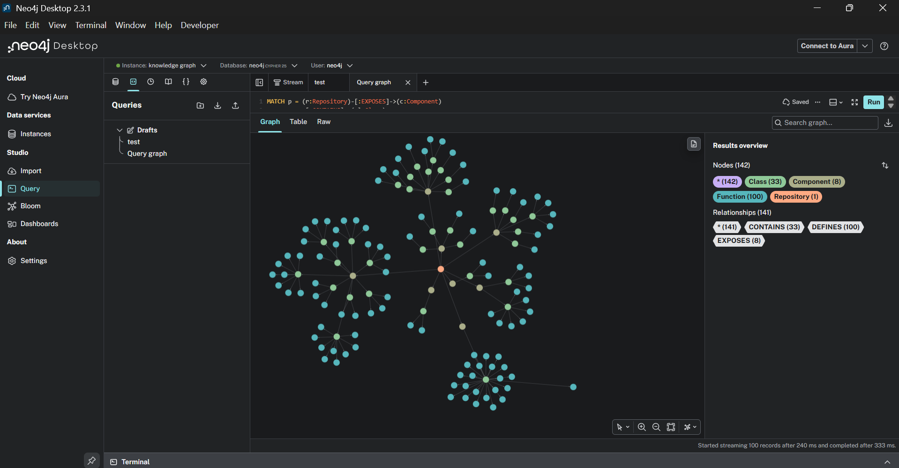
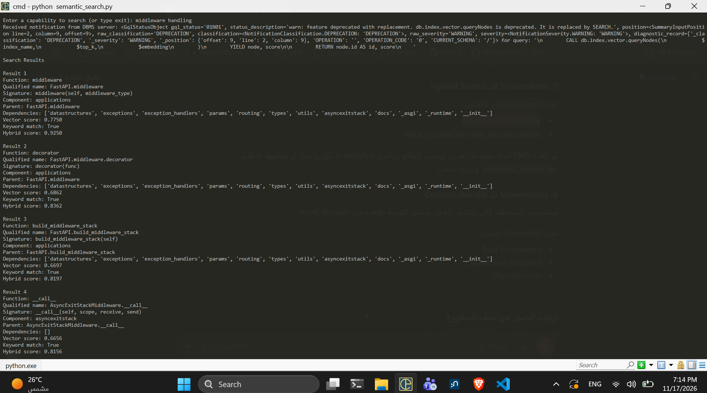

# Component Knowledge Graph

A Knowledge Graph prototype for extracting software architecture and retrieving reusable components to support automated architecture assembly.

## Overview

The project uses Python AST to extract software components, classes, functions, and dependencies from open-source repositories and store them in Neo4j.

It supports graph-based, semantic, and hybrid retrieval, followed by Context Bundle construction.

## Technology Stack

- Python & Python AST
- Neo4j & Cypher
- Sentence Transformers
- all-MiniLM-L6-v2
- Git & GitHub

## Dataset

- [FastAPI](https://github.com/fastapi/fastapi)
- [Pydantic](https://github.com/pydantic/pydantic)

## Extraction Results

| Entity | Count |
|---|---:|
| Repositories | 2 |
| Components | 107 |
| Classes | 312 |
| Functions | 1,541 |
| Dependencies | 117 |

## Key Features

- AST-based code extraction.
- Knowledge Graph construction.
- Component and dependency retrieval.
- 384-dimensional semantic embeddings.
- Hybrid search combining vector similarity and keyword matching.
- Context Bundle construction.

## Screenshots

## Limitations & Future Work

- Improve dependency and function mapping.
- Complete API and documentation extraction.
- Implement incremental graph updates.
- Improve retrieval and reranking.

## Author

**Yasmin Kasem**

B.Sc. in Physics, Mansoura University
